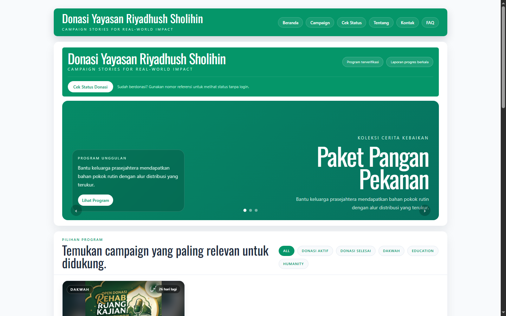
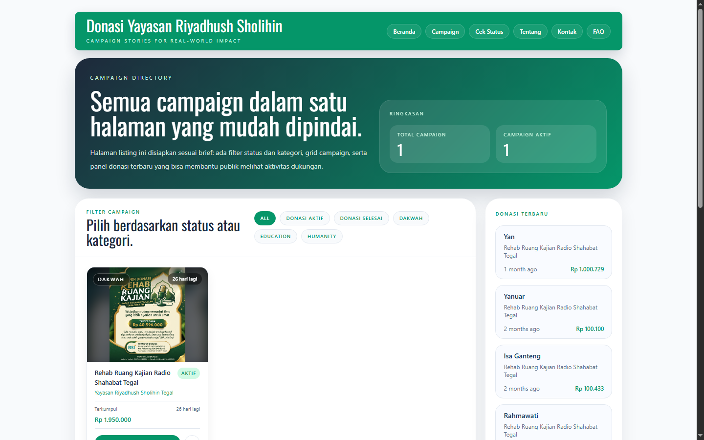
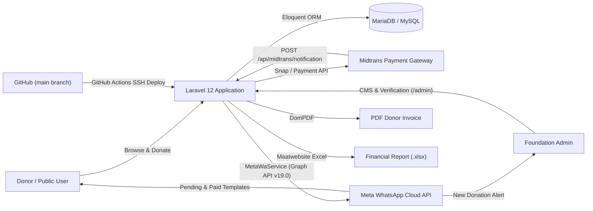
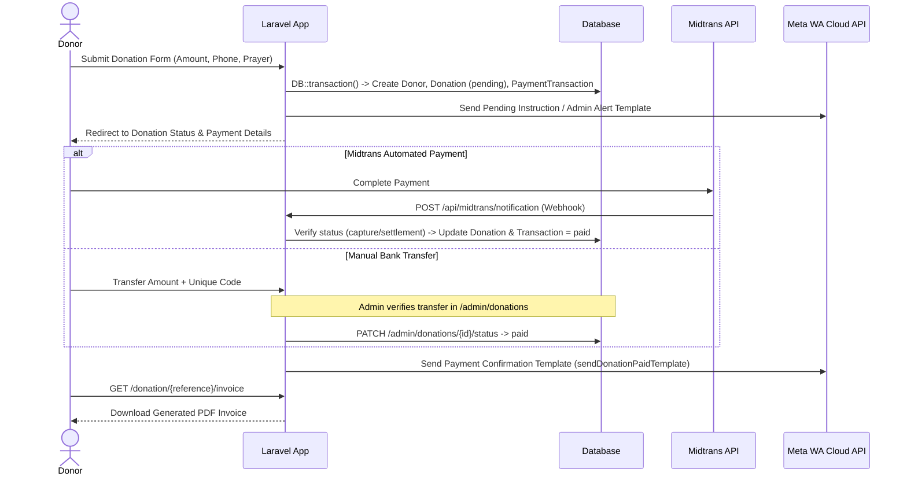
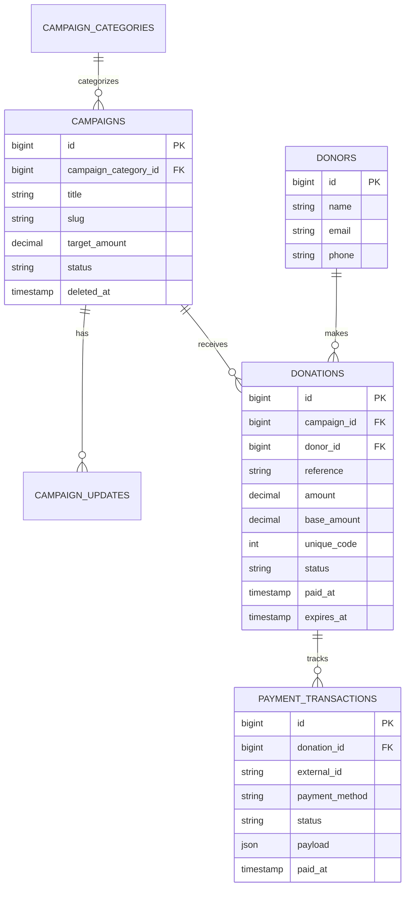

# Donasi Yayasan — Production Crowdfunding & Donation Platform (Engineering Case Study)

> **Live Production:** [donasi.yarish-tegal.com](https://donasi.yarish-tegal.com)  
> **Repository Note:** This repository is a **public engineering case study** documenting the architecture, database design, payment/notification workflows, and CI/CD pipeline of a live client production system built for **Yayasan Riyadhush Sholihin (Tegal)**. Proprietary client source code is maintained in a private repository.

---

## Business Problem & Engineering Impact

Previously, donation collection relied on manual chat confirmations, bank mutation checks, and manual spreadsheet recaps. I designed and shipped an end-to-end production web platform that automates the full lifecycle from donor checkout to financial reporting:

- **End-to-End Donation Lifecycle:** Donors browse campaigns, donate online, track status by reference code without login, and download **PDF invoices** (`DomPDF`) directly.
- **Dual Payment Architecture:** Supports **Midtrans Payment Gateway** (real-time webhook verification) and **Manual Bank Transfer** with automated unique transfer codes.
- **Automated WhatsApp Notifications:** Integrated with **Meta WhatsApp Cloud API (v19.0)** to send structured Indonesian templates for pending instructions, admin alerts, and payment confirmations.
- **Self-Service Admin CMS & Reporting:** Full back-office panel for managing campaigns, categories, updates, banners, FAQs, testimonials, static pages, WA reply templates, and **Excel financial exports** (`maatwebsite/excel`).
- **Automated CI/CD:** Zero-manual-step production deployment via **GitHub Actions** over SSH with safe maintenance-mode rollback (`trap`), automated migrations, and Laravel production caching.

---

## Live Production Screenshots

| Public Home & Hero | Campaign Directory & Live Feed |
| :---: | :---: |
|  |  |

---

## System Architecture

---

## Donation & Payment Sequence Flow

---

## Core Database Schema (ERD)

---

## Key Engineering Highlights

1. **Atomic Donation Creation:** Donor lookup/creation, donation record generation, unique transfer code calculation, and payment transaction logging are wrapped inside `DB::transaction()` to guarantee data consistency.
2. **Idempotent Midtrans Webhook Handling:** `MidtransWebhookController` maps Midtrans `transaction_status` (`capture`, `settlement`, `pending`, `cancel`, `deny`, `expire`) and `fraud_status` (`challenge`, `accept`) into clean internal states while persisting raw gateway payloads as JSON for auditability.
3. **Resilient Meta WhatsApp Cloud API Wrapper (`MetaWaService`):** Normalizes Indonesian phone formats (`08...` -> `628...`), reads credentials from `.env` with dynamic database `Settings` fallback, enforces a 5-second HTTP timeout, and logs failures gracefully without blocking user checkout.
4. **Safe SSH CI/CD Deployment:** GitHub Actions workflow uses `php artisan down` with a bash `trap 'php artisan up || true' EXIT` safeguard so the production site never stays stuck in maintenance mode if a deployment step fails.

---

## Tech Stack

| Layer | Technologies |
| :--- | :--- |
| **Backend** | PHP 8.2+, Laravel 12, Eloquent ORM, OOP / MVC |
| **Frontend** | Blade Templates, Tailwind CSS v4, Vite 7, Axios |
| **Database** | MariaDB / MySQL (Production), SQLite (Local Development) |
| **Integrations** | Midtrans PHP SDK (`^2.6`), Meta WhatsApp Cloud API (`v19.0`) |
| **Reporting** | `barryvdh/laravel-dompdf` (PDF Invoice), `maatwebsite/excel` (Excel Export) |
| **DevOps & QA** | GitHub Actions (SSH CI/CD), PHPUnit 11, Laravel Pint, Playwright |

---

## Author

**Isa Mas'ud** — Full-Stack Web Developer  
- Portfolio: [port.private-isa.my.id](https://port.private-isa.my.id)  
- LinkedIn: [linkedin.com/in/isamasud](https://linkedin.com/in/isamasud)  
- GitHub: [github.com/isamsd26](https://github.com/isamsd26)
